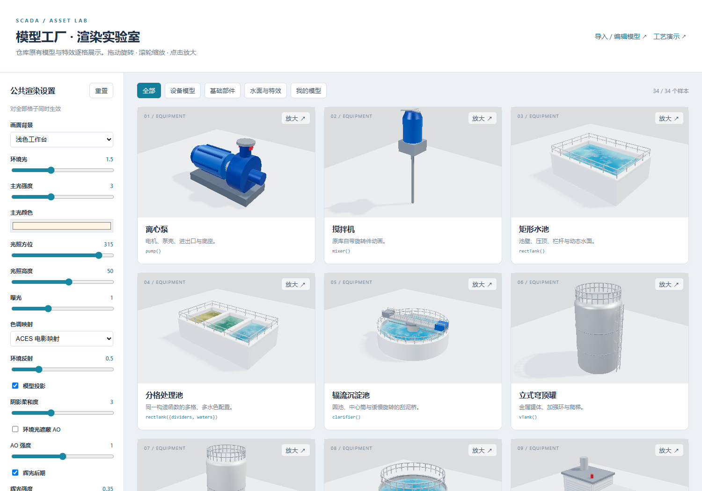

# WebGL CMR Platform

浏览器端 2.5D SCADA / HMI 可视化原型，提供模型工厂展示、公共渲染实验室，以及本地 GLB / FBX 模型编辑与模型库。



## 快速启动

安装 Node.js 18+、npm 和 Python 3，在项目根目录执行：

```bash
npm ci
npm start
```

- [模型工厂与渲染实验室](http://localhost:8080/gallery.html)：34 个内置样本，统一调整灯光、阴影、AO、辉光与动画。
- [自定义模型编辑器](http://localhost:8080/editor.html)：导入 GLB / FBX 和贴图，编辑变换、设备信息与管线接口，保存到浏览器本地模型库。
- [工艺演示](http://localhost:8080/index.html)：调节池、双提升泵和反应罐，包含模拟故障、备用泵切换及报警。

完整说明、截图、目录结构、测试方法和原库模型属性见 **[项目文档](doc/README.md)**。

目前数据为浏览器仿真，未接入真实 PLC。模型库保存在当前浏览器、当前来源地址的 IndexedDB 中，文件不上传服务器；导出配置 JSON 不包含模型文件。

本项目基于 [agentthink/scada-hmi-builder](https://github.com/agentthink/scada-hmi-builder) 的模型工厂、可视化代码与示例扩展，采用 **AGPL-3.0-only**。上游署名与版本见 [来源说明](doc/UPSTREAM.md)，许可证见 [LICENSE](LICENSE)。
