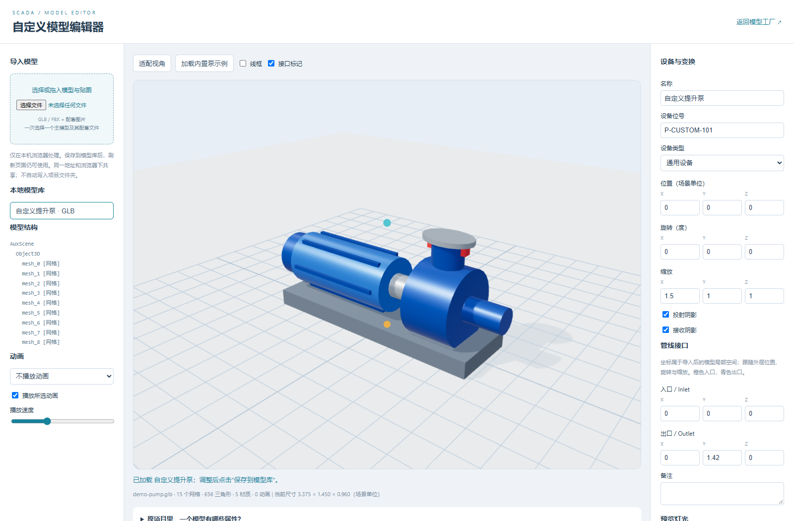

# WebGL CMR Platform 使用说明

用于工业设备模型预览、渲染效果对比与工艺画面原型验证。基于 Three.js，前端使用原生 JavaScript ES Modules，Python 提供本地静态服务。

## 已有功能

### 模型工厂与渲染实验室

`gallery.html` 展示 34 个内置样本：14 个设备模型及配置变体、10 个基础部件/材质/文字样本、10 个水面与特效样本。设备包括泵、搅拌机、水池、沉淀池、储罐、风机、锅炉、洗涤塔等。

- 每格独立旋转、缩放和放大；支持按类别筛选。
- 统一调整环境光、主光颜色/强度/方位/高度、环境反射、曝光与色调映射。
- 调整投影、阴影柔和度、AO、辉光、动画速度、自动旋转和线框。
- 日间、夜间辉光、侧光阴影预设。
- 水面、泡沫/曝气、管线流动、粒子、扫描带、全息底座、报警光柱和轮廓描边。
- 读取同一浏览器下保存的自定义模型，放入“我的模型”分类。

每格按自身包围盒适配镜头，格子之间不表示真实尺寸比例。渲染使用单一 WebGL 上下文，只绘制屏幕内可见格子。

### 自定义模型编辑器



`editor.html` 支持：

1. 选择或拖入一个 GLB / FBX 主模型，以及配套图片。
2. 查看三维预览、节点层级、尺寸、网格/三角形/材质数量和动画列表。
3. 编辑名称、设备位号、类型、备注、位置、三轴旋转/缩放、投射/接收阴影。
4. 设置入口/出口局部坐标，显示接口标记。
5. 预览动画与灯光，保存模型原文件、资源与配置到本地模型库。
6. 重新打开已保存条目继续编辑，或导出配置 JSON。

也可以使用“加载内置泵示例”先体验完整流程。

### 工艺示例

`index.html` 展示“调节池 → 一用一备提升泵 → 反应罐”。支持浏览器内仿真数据、故障模拟、备用泵自动切换、报警确认、离线显示、分区视角和 PNG 导出。

## 启动

需要 Node.js 18+、npm、Python 3 和支持 WebGL 的现代浏览器。自动化测试额外使用本机安装的 Google Chrome。

```bash
git clone https://github.com/ndsl95/WebGL-CMR-Platform.git
cd WebGL-CMR-Platform
npm ci
npm start
```

打开 http://localhost:8080/gallery.html 。编辑器在 http://localhost:8080/editor.html ，工艺示例在 http://localhost:8080/index.html 。

也可以运行 `python serve.py 8080`；只有 `python3` 命令的系统使用 `python3 serve.py 8080`。服务终端用 Ctrl+C 停止。当前服务是开发静态服务器，会监听所有网络接口，不提供登录或生产部署功能。

## 导入与存储说明

- 每次选择一个主模型，外部贴图须一起选择；资源按文件名匹配，同名冲突需要先改名。
- GLB 支持内嵌图片，也支持同时选择的外部图片。FBX 的实际兼容范围取决于 Three.js FBXLoader。
- Draco / Meshopt 压缩 GLB 尚未配置解码器，请先输出未压缩 GLB。
- 模型尺寸沿用加载器解析后的场景单位，根据源模型情况手动换算缩放。
- 原文件与配置保存到 IndexedDB，按浏览器与来源地址隔离。`localhost` 与 `127.0.0.1`、不同端口并不是同一个模型库。
- 清理浏览器站点数据会移除本地模型库。请保留原模型和贴图；导出的 JSON 仅包含配置。
- 保存不会自动把模型写进项目文件夹、提交到 GitHub 或接入工艺场景的业务逻辑。

## 原模型的属性

原库没有统一的“设备模型属性表”，主要由构造参数、三维对象属性、userData 和外部设备台账/状态组成。

例如 `pump({scale, color})` 的 `color` 实际是材质对象；`vTank()` 支持半径、高度、顶部/底部形状、支腿、材质、栏杆、爬梯等参数。运行/故障/自动手动状态另外保存在 `sim.js` 中。

完整清单见 [模型编辑与原库属性](模型编辑与原库属性.md)。

## 目录

```text
gallery.html          模型展示与渲染实验室
editor.html           自定义模型编辑器
index.html            工艺演示
js/
  gallery.js          多格渲染与公共设置
  editor.js           编辑器交互、预览与模型库
  model-assets.js     GLB/FBX 加载、变换配置与 IndexedDB
  factory.js          上游模型/管道/水面工厂
  engine.js           上游可视化封装
  fx.js               上游特效
  plant.js            示例场景布局
  sim.js              示例台账与仿真
  main.js             示例界面驱动
css/                  页面样式
doc/                  文档、测试脚本与截图
serve.py              本地静态服务
LICENSE               AGPLv3 许可证
```

## 验证

先启动本地 8080 服务，在另一终端执行：

```bash
npm test
```

测试使用独立的临时浏览器上下文，不修改用户正常浏览器中的模型库。测试自动创建 `exports/` 存放截图，结果写到 `doc/*-verification.json`；这些生成产物不提交。

- 展示页：样本初始化、无脚本/着色器错误、灯光/阴影控制、AO、分类、放大关闭、动画暂停。
- 编辑器：GLB、内嵌/外部贴图、动画 GLB、基础 ASCII FBX、元数据/变换/接口保存与刷新恢复、无效文件处理、展示页读取本地库。

这不等同于验证所有来源的 FBX、复杂骨骼/材质、超大模型或跨浏览器兼容性。当前没有真实 PLC、历史数据库、权限系统和生产级数据采集。

## 来源与许可

基于 [agentthink/scada-hmi-builder](https://github.com/agentthink/scada-hmi-builder) 扩展，原始模型工厂、特效、可视化代码、页面模板及样式保留上游许可。本项目使用 AGPL-3.0-only；第三方依赖保留各自许可证。

详见 [UPSTREAM](UPSTREAM.md) 和根目录 [LICENSE](../LICENSE)。
